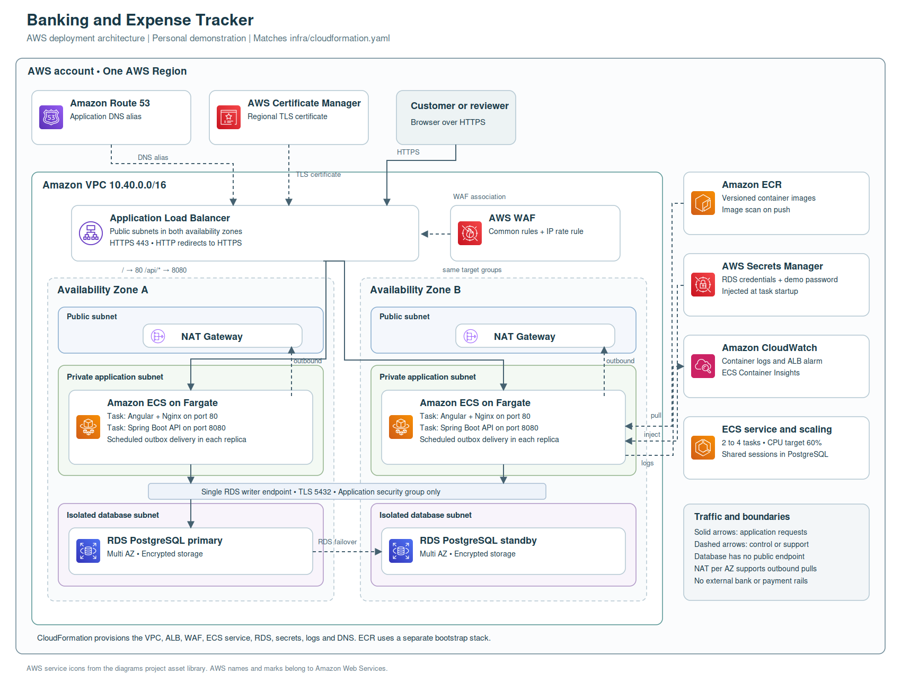

# Banking and Expense Tracker

A complete personal demonstration application with an Angular UI, Spring Boot API, PostgreSQL schema, tests, Docker Compose, and AWS infrastructure templates. All account funds are simulated. Manual expenses and income are observations: they affect budgets and reports but never move account balances.



## Features

- Secure session login and logout, CSRF protection, password hashing, rate limiting, customer isolation, reviewer authorization, shared JDBC sessions and absolute session expiry.
- Zero balance account creation, account closure, shareable recipient references, beneficiaries and cursor based transaction history.
- Atomic internal transfers using `@Transactional`, ordered PostgreSQL account locks, integer cents, balanced immutable ledger entries, durable idempotency and an audit trail.
- Fraud rules for single amount, new beneficiary, daily amount and velocity, plus an independent approve or reject screen.
- Manual expense and income creation, editing and soft deletion; customer categories; monthly budgets; 80 and 100 percent alerts.
- Chart.js category and cash flow charts, equivalent accessible tables, date filters and CSV exports.
- Transactional outbox with deduplicated in-app delivery and scheduled balance reconciliation.

## Quick start with Docker

Install Docker Desktop with Compose. Extract the ZIP and open this root folder in VS Code.

```bash
cp .env.example .env
```

On Windows PowerShell use `Copy-Item .env.example .env`. Edit `.env`, replacing both passwords with your own values. `DEMO_PASSWORD` must have at least 12 characters. Then:

```bash
docker compose up --build
```

Open **http://localhost:4200** after the backend has started. Initial Maven and npm dependency downloads may take several minutes.

| Login | Purpose |
|---|---|
| alice@demo.local | Customer, USD 25,000 simulated checking balance, Bob already saved as beneficiary |
| bob@demo.local | Second isolated customer with USD 25,000 simulated balance |
| reviewer@demo.local | Independent fraud reviewer |

All three use your `DEMO_PASSWORD`. The backend seeds them only when the user table is empty. Credentials in `.env` are local configuration, never commit that file. Changing `.env` does not change existing database password hashes.

Try these flows:

1. Sign in as Alice. View the dashboard, expenses and budgets.
2. Transfer USD 125.50 to Bob. Verify Alice's balance and history, then sign in as Bob and verify his balance and history.
3. Submit USD 6,000 from Alice. It is held without reserving funds. Sign in as the reviewer, enter a reason, and approve it. Refresh Alice's status.
4. Add a manual expense that crosses a budget threshold. Wait two seconds, then refresh Alerts.

Only five submitted transfer attempts per rolling ten minutes are allowed before the sixth is rejected. Idempotent retries do not count as new attempts. Run tests against a separate database, not your demo volume.

```bash
docker compose down
```

This keeps the database volume. `docker compose down -v` irreversibly removes local demo data and lets the next start seed again.

## Develop without containerizing the applications

Prerequisites: Java 17, Maven 3.9, Node 24, npm and PostgreSQL 16. The application deliberately uses Spring JDBC for explicit SQL locking and transactional services; JPA is not required.

Start just PostgreSQL with `docker compose up -d db`. Set `DB_PASSWORD` from `.env` in your shell. Set `COOKIE_SECURE=false`, `DEMO_ENABLED=true`, `DEMO_PASSWORD` and `DB_URL=jdbc:postgresql://localhost:5432/expense`. Run these in separate terminals:

```bash
cd backend
mvn spring-boot:run
```

```bash
cd frontend
npm ci
npm start
```

Angular proxies `/api` to port 8080. For debugging in VS Code install Extension Pack for Java, Spring Boot Extension Pack and Angular Language Service. Open `backend/pom.xml` as the Java project. No external Tomcat installation is needed.

## Verify

```bash
cd backend
mvn verify
```

Backend tests start an isolated PostgreSQL 16 Testcontainer, so Docker must be running. Alternatively set `TEST_DB_URL`, `TEST_DB_USER` and `TEST_DB_PASSWORD` to a **dedicated empty test database**. The test profile seeds demo users with a test-only password. Tests insert data and exercise database constraints. They are not safe for a live dataset.

```bash
cd frontend
npm ci
npm test
npm run build -- --configuration production
```

```bash
pip install cfn-lint
cfn-lint infra/cloudformation.yaml infra/registry.yaml
```

See [verification results](docs/verification.md) for what was actually run in the generation environment, including limitations. GitHub Actions includes Docker-backed concurrency tests.

## Project contents

```text
backend/                 Spring Boot source, migration, tests, Dockerfile, RDS CA bundle
frontend/                Angular source, Chart.js UI, lockfile, tests, Nginx configs
infra/registry.yaml      ECR bootstrap stack
infra/cloudformation.yaml VPC, ALB, WAF, ECS, RDS, secrets, logs, DNS and scaling
scripts/build-push.sh     Build AMD64 images and push to existing ECR repositories
scripts/api-smoke.py      Cookie and CSRF based smoke test against a running local demo
docs/openapi.yaml         API contracts
docs/aws-architecture.*   PNG, editable SVG and Mermaid source
docs/aws-deployment.md    AWS setup, deployment, operations and cleanup
docs/implementation.md   Money invariants, lock order, design decisions and scope
.github/workflows/ci.yml  Backend, frontend and infrastructure validation
```

## AWS deployment

Read [the AWS guide](docs/aws-deployment.md). Templates and scripts are supplied; no resources have been deployed. The AWS stack creates billable services including two NAT gateways and Multi AZ RDS. Use a disposable demo account or environment. HTTPS requires your domain, public hosted zone and a validated regional ACM certificate.

The deployment remains a demonstration. Real money, external banks, cards, KYC, FX, registration, MFA, account recovery and regulatory certification require separate work. There is no affiliation with any banking organization.
